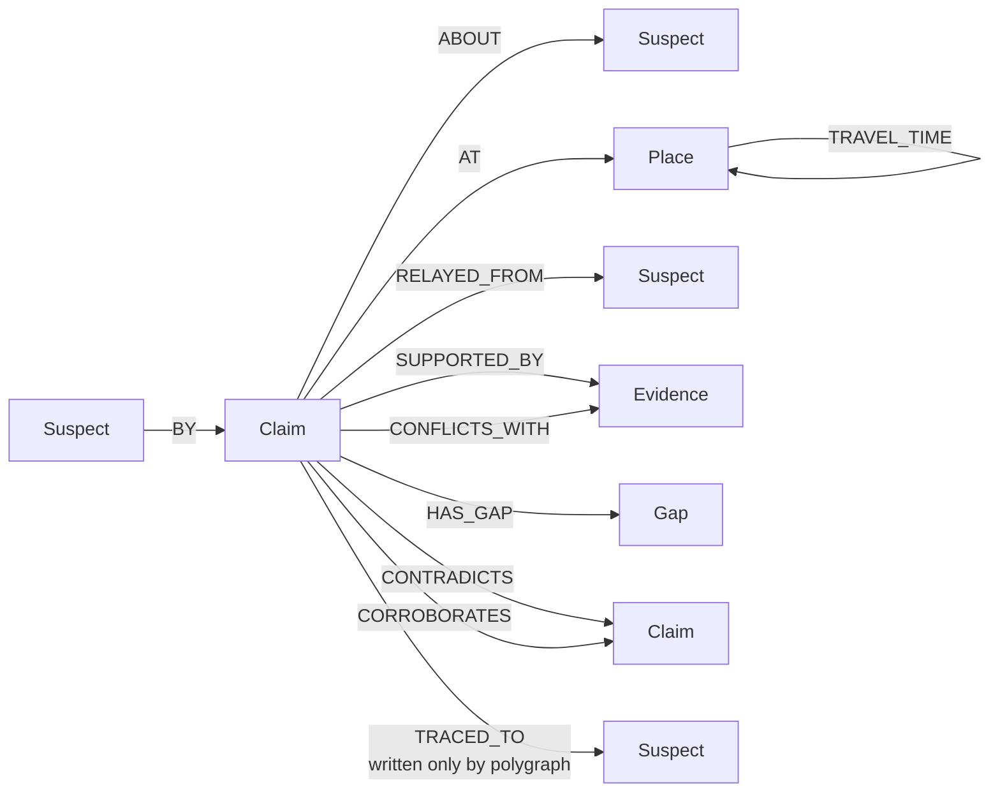
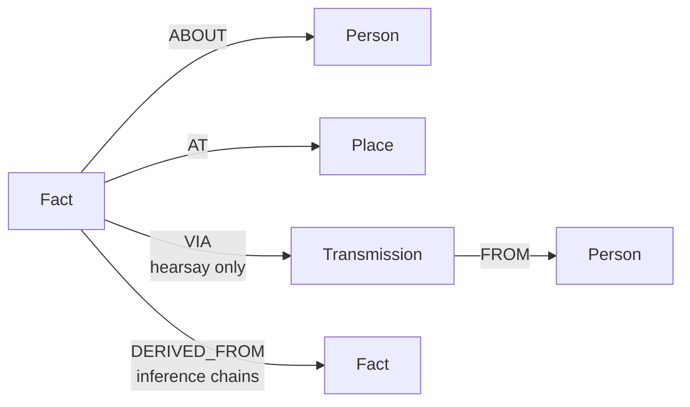

# Alibi

**Seven suspects. One evening. Everybody's lying about something — and the graph knows who can't back it up.**

A murder mystery where the detective is an AI agent, the suspects each have their own
private memory, and every single statement gets checked against the speaker's own head
before anyone is allowed to believe it. Built on [FalkorDB](https://www.falkordb.com/).

It looks like this:


Built solo for **Graph Hacks: Context for AI Agents** (FalkorDB × WeMakeDevs), inside the
window (Oct 15 → Oct 18 IST). Tracks: **Agent Memory and Coordination** (primary),
**Agents That Act on Connected Data** (secondary).

---

## The idea

Multi-agent systems have a problem: agents say things, and other agents just... believe them.
There's no step where anybody asks *"hang on, how do you know that?"*

So I built that step, and wrapped a detective game around it to prove it works.

Each suspect gets a private memory graph — things they saw, things they were told, things
they worked out. When a suspect says *"Avery was in the ballroom at 18:02"*, the engine goes
into **that suspect's own memory** and asks whether anything in there actually backs it up.
Then it hands down one of five verdicts:

| | means |
|---|---|
| `SUPPORTED` | they saw it themselves. checks out. |
| `UNSUPPORTED` | nothing in their memory touches this. **not** "they lied" — maybe they blinked. |
| `CONTRADICTED` | their *own* memory puts that person somewhere else at the same time. awkward. |
| `INDETERMINATE` | partly backed. the uncovered minutes get recorded as gaps. |
| `HEARSAY` | they only heard it. so now it depends on somebody else's memory. |

The important bit: **no model decides any of this.** Verdicts come out of Cypher and about
fifteen lines of interval arithmetic. The AI detective only picks *which question to ask next*.
You could swap it for a random tool-picker and every verdict in the case file would be
identical — you'd just get a worse investigation.

I'm not claiming to detect lies. I'm claiming to tell you, exactly and with receipts,
how much of what someone said their own memory can account for.

## See it run

Two commands, no API key, no model needed:

```bash
make up && make venv
FALKOR_PORT=6380 .venv/bin/python -m scripts.run_detective --seed 7777
```

Real output (trimmed):

```
PASS 1 - recording
  -> rank_suspects()                                    7 rows
  -> list_gaps(suspect='p3')                            3 rows
  -> interview(suspect='p3', about='p1', t0=2, t1=6)    1 rows
  -> list_contradictions()                             20 rows
  -> polygraph(suspect='p3', claim_id='p3-c1')
     p3-c1: INDETERMINATE, coverage 0.58, 2 gaps, chain ORIGIN_WITNESSED
  -> accuse(suspect='p3', ...)

  stopped            accused after 6 turns
  polygraphs spent   1 of 2
  API CALLS          6

PASS 2 - replay-only, no transport configured
  cache hits         6
  API CALLS          0

identical investigation:  True
```

Every line there is a Cypher query. `rank_suspects` is Q8, `list_contradictions` is Q5+Q6,
`list_gaps` reads the `Gap` nodes the audit wrote, and `polygraph` is the cross-graph
provenance walk. Pass two replays the whole case from cache and calls nothing.

### Or watch it on the board

```bash
FALKOR_PORT=6380 .venv/bin/python -m uvicorn backend.app.main:app --port 8000
cd frontend && npm install && npm run dev
```

→ **`http://localhost:5178/?seed=7777&investigate=1`**

The board opens a case and the detective starts working. Claims appear, the tally fills in,
the contradiction counter climbs as the travel checks run, and the two little green pips on
the polygraph go out as the detective spends its budget. It's all live off an SSE stream.

Drop the `&investigate=1` and you get a committed fixture instead, so it works with no
backend at all.

## Why FalkorDB is doing actual work here

Not "we stored some nodes in it". The whole thing collapses without it:

- **Memory isolation is the architecture.** Every suspect is a separate graph. There is no
  edge between them. The *only* thing that can cross is the referee — which is exactly what
  makes "where did you hear that?" a real question instead of a self-report.
- **The travel check is a graph algorithm.** Can Cato get from the kitchen to the study in
  four minutes? `algo.SPpaths` over the floor plan says no, so that pair of statements can't
  both be true. (I cross-check every weight against my own Floyd-Warshall pass, because I
  didn't trust myself.)
- **Contradictions, gaps, the suspect ranking — all Cypher.** Not rows pulled into Python and
  looped over.

## The graph

Three graphs, keyed by seed. All time intervals are half-open `[t0, t1)`.

- `world:{seed}` — what actually happened. **Referee only.** The detective can never touch this.
- `mind:{seed}:{agent}` — one private memory per suspect.
- `case:{seed}` — the public case file. This is all the detective sees.

### `case:{seed}` — the case file



| Node | Properties |
|---|---|
| `Suspect` | `id`, `name` |
| `Place` | `id`, `name` |
| `Incident` | `id`, `place`, `t0`, `t1` |
| `Claim` | `id`, `t0`, `t1`, `turn`, `modality`, `verdict`, `coverage`, `uncovered` |
| `Evidence` | `id`, `fact_id`, `src`, `t0`, `t1`, `place`, `agent` — a **redacted shadow** of a private memory, never the memory itself |
| `Gap` | `t0`, `t1` — minutes of a claim nobody's memory covered |

| Edge | What it means |
|---|---|
| `(Place)-[:ADJACENT_TO {minutes}]->(Place)` | the floor plan |
| `(Place)-[:TRAVEL_TIME {minutes}]->(Place)` | precomputed all-pairs shortest walk |
| `(Claim)-[:BY\|ABOUT\|AT]->(...)` | who said it, about whom, where |
| `(Claim)-[:RELAYED_FROM]->(Suspect)` | "X told me" |
| `(Claim)-[:SUPPORTED_BY {covers_t0,covers_t1}]->(Evidence)` | a memory backing it, and which slice it covers |
| `(Claim)-[:CONFLICTS_WITH]->(Evidence)` | a memory that disagrees |
| `(Claim)-[:HAS_GAP]->(Gap)` | unaccounted minutes |
| `(Claim)-[:CONTRADICTS {kind, pair_id}]->(Claim)` | `exclusive_presence` or `impossible_travel` |
| `(Claim)-[:CORROBORATES {pair_id}]->(Claim)` | two independent people agree |
| `(Claim)-[:TRACED_TO {role, terminal, ungrounded, depth}]->(Suspect)` | where a rumour started — **only written when the detective pays for it** |

### `mind:{seed}:{agent}` — one private head per suspect



| Node | Properties |
|---|---|
| `Fact` | `id`, `kind`, `src` (`witnessed` / `hearsay` / `inferred`), `t0`, `t1`, `learned_at` |
| `Transmission` | `id`, `tick`, `src_agent`, `src_fact_id` — the record of *how* a rumour arrived |

The audit reads a mind, decides, and writes back only a redacted shadow and a gap. Never the
memory itself. That's the whole privacy seam, and it's enforced in code, not by politeness.

## The queries

| # | Query | What it answers |
|---|---|---|
| Q1 | `WRITE_FACT` / `WRITE_TRANSMISSION` / `WRITE_DERIVATION` | fill a suspect's memory when the world is generated |
| Q2 | `GATHER_EVIDENCE` | everything in one mind overlapping a claim — supporting *and* conflicting in one pass, so a supporting memory can't mask a conflicting one by being read first |
| Q3 | the provenance walk | hop from mind to mind following "who told you?" until it ends in one of **three origin states** or **four failure terminals** (broken, cyclic, too deep, or — my favourite — told before it happened) |
| Q4 | `INGEST_CLAIM` | record a statement; rejects zero-length and inverted windows at the door |
| Q5 | `EXCLUSIVE_PRESENCE` | same person, two rooms, overlapping time |
| Q6 | `IMPOSSIBLE_TRAVEL` | the walk between those rooms is longer than the gap between the statements |
| Q7 | `CORROBORATION` | two independent people put someone in the same place |
| Q8 | `SCOREBOARD` | per-suspect totals, splitting rumours you *started* from rumours you merely *repeated* — otherwise the gossip scores the same as the source |
| — | `algo.SPpaths` | shortest walk between rooms, cross-checked against Floyd-Warshall |

## The detective's seven tools

`interview`, `list_contradictions`, `list_gaps`, `check_travel`, `rank_suspects`,
`polygraph`, `accuse`.

All of them run over the public case file. None of them can name a private mind.

`polygraph` is the interesting one: **two per case, that's it.** It's the only way to see where
a rumour started, and the only thing that writes a `TRACED_TO` edge. So the budget isn't
decoration — spend both looks badly and you finish the case blind.

Every model call goes through a SQLite replay cache keyed by `(seed, agent, prompt_hash)` plus
a hard call cap. Record a case once, replay it forever at zero cost. There's a test that
asserts this against a transport which **throws if anything touches it**, because a counter
reading zero proves nothing.

No vendor SDK is pinned and no model is named anywhere in this repo — the transport is a
callable you point `ALIBI_COMPLETER` at.

## Setup

```bash
git clone https://github.com/AugustusWayne/alibi.git
cd alibi
cp .env.example .env     # FALKOR_HOST_PORT=6380, to dodge whatever's on 6379
make up                  # FalkorDB v4.22.1, pinned by tag + digest
make venv
make verify              # ruff + 201 tests
```

Docker, Python 3.12+, Node 18+ for the board.

| | |
|---|---|
| `make up` / `make down` | FalkorDB |
| `make spikes` | nine FalkorDB assumptions I checked before building on them |
| `make verify` | lint + tests. nothing ships until this is green |
| `make eval` | the benchmark |

## Numbers

24 seeds, frozen and committed *before* I generated any of them. 3,086 claims. Scripted
suspects, no model anywhere in the run.

| | |
|---|---|
| Falsehood detection | **100% precision** (31 caught, **0 false accusations**), 70.5% recall |
| Origin identification | **12 / 12** |
| Chain root identification | **498 / 498** |
| Gap precision | **0 of 182** 😬 |

The zero false positives is the number I actually care about. The engine never once called a
true statement unaccounted-for.

**The 13 it missed** are all the same shape: a falsehood passed along secondhand with nothing
anywhere contradicting it. There is genuinely nothing in anybody's memory to catch those with.
That's the honest ceiling on this approach, not a bug I ran out of time to fix.

**The gap precision is bad and I'm leaving it in.** 181 of those 182 gaps mark the edge of a
*witness's* memory rather than someone actually being somewhere else. With scripted suspects
the generator barely produces false witnessed testimony, so the metric has almost nothing to
find. It's close to a structural zero. It's also the best argument for LLM suspects, which I cut.

Nothing was tuned. The scoreboard weights were frozen before the first run and the eval never
reads them.

## What I didn't get to

- **LLM suspects (M3) — cut.** Suspects are scripted. They're a real component, not a stub —
  deterministic testimony with an explicit fabrication policy — but it means the gap metric
  above has nothing to chew on.
- **The three-arm detective comparison — not run.** No transcript-only arm, no retrieval arm,
  no accuracy figure with a confidence interval. I'm not going to invent one.
- **A real model drove it exactly once.** Seed 7777, 7 turns, spent one polygraph, named a
  suspect. That's a smoke test to prove the loop works with a model in it — one case, through
  a setup tied to my laptop, not reproducible, no control. **I'm making no accuracy claim from
  it**, in either direction.

## Reproducing

```bash
make spikes     # 9 assumptions: 8 pass, 1 skipped (MCP, optional and cut)
make verify     # 201 tests
make eval       # 24 seeds → eval/results.json
```

The `eval/results.json` in this repo is the real output of that command.

## License

None yet — all rights reserved pending a decision after the hackathon.

## AI assistance

An AI coding assistant was used throughout. See [`AI-USE.md`](AI-USE.md).
