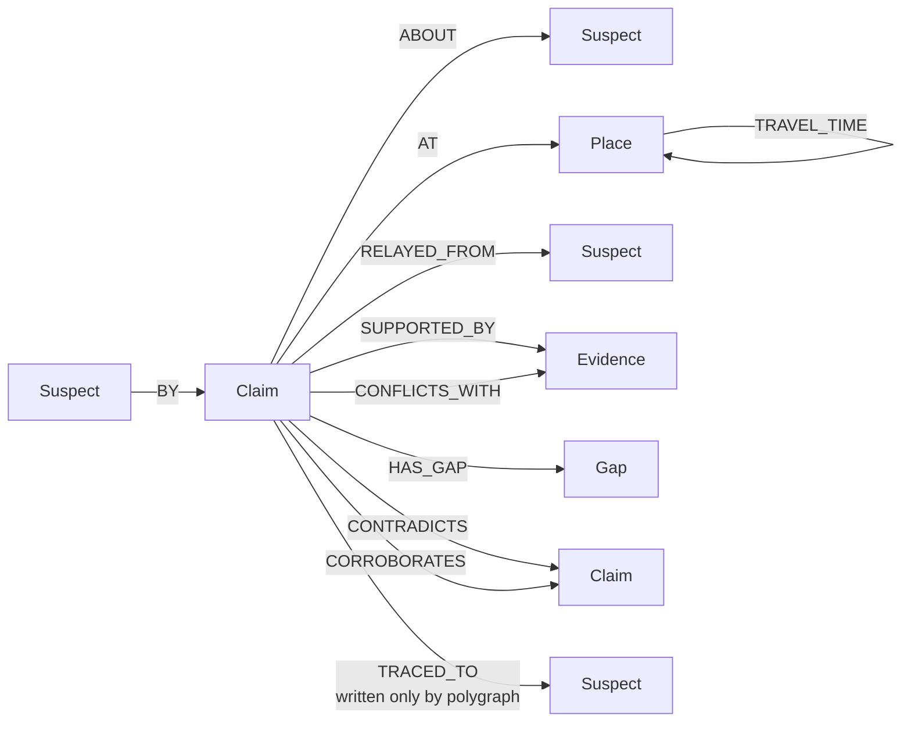
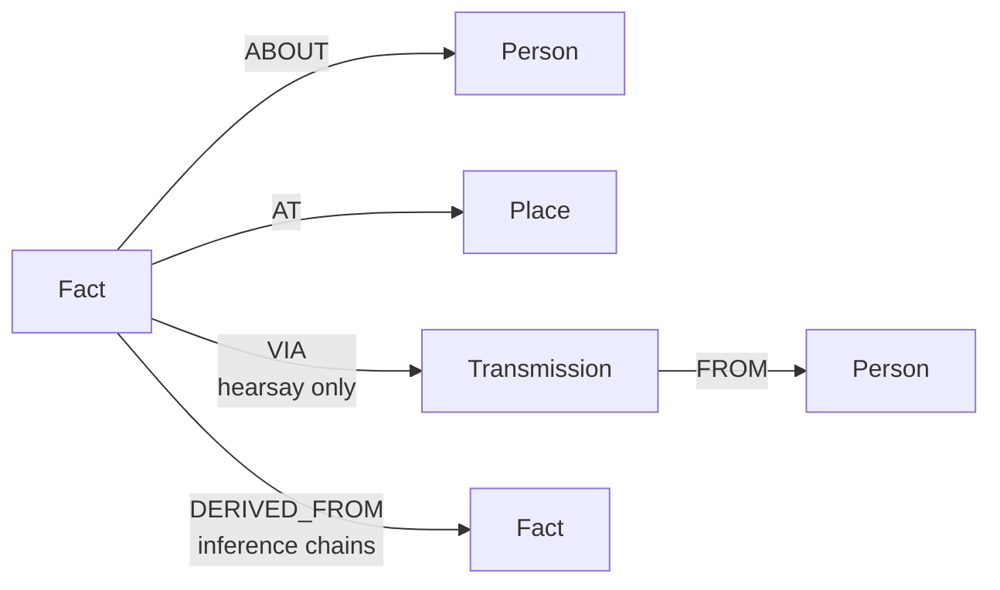

# Alibi — every claim needs a path

An epistemic audit layer for multi-agent systems, built on **FalkorDB**.

Seven suspects each hold a private memory graph. A detective agent can
interview them, but only ever sees claims that have already been
graph-audited against **each suspect's own memory**: is this grounded,
contradicted, unaccounted for, or resting on something they were only told?
The detective's entire toolset is a set of typed Cypher-backed operations
over a shared **case graph** — it never reads a mind directly, and it never
sees the answer key.

Built solo for **Graph Hacks: Context for AI Agents** (FalkorDB × WeMakeDevs),
entirely inside the hackathon window (Oct 15 12:01 AM IST → Oct 18 11:59 PM
IST). Planning and spec work predate the window; all code was written in it.

**Tracks entered:** Track 2 — Agent Memory and Coordination (primary),
Track 1 — Agents That Act on Connected Data (secondary).

**AI assistance disclosure:** this project was built with an AI coding
assistant. [`AI-USE.md`](AI-USE.md) is a per-milestone log of what was
generated, what was found and fixed along the way, and what is still pending
review — kept honestly rather than cleaned up for submission.

---

## Demo — the agent running start to finish

Two commands after setup, no credential and no model required:

```bash
make up && make venv
FALKOR_PORT=6380 .venv/bin/python -m scripts.run_detective --seed 7777
```

Real output, abridged — a full investigation over the graph, then the same
case replayed from cache:

```
PASS 1 - recording
  -> rank_suspects()                                    7 rows
  -> list_gaps(suspect='p3')                            3 rows
  -> interview(suspect='p3', about='p1', t0=2, t1=6)    1 rows
  -> list_contradictions()                             20 rows
  -> polygraph(suspect='p3', claim_id='p3-c1')
     p3-c1: INDETERMINATE, coverage 0.58, 2 gaps, chain ORIGIN_WITNESSED
  -> accuse(suspect='p3', ...)

  stopped            accused after 6 turns
  polygraphs spent   1 of 2
  traces in case     2
  API CALLS          6

PASS 2 - replay-only, no transport configured
  ... identical tool calls, identical accusation ...
  cache hits         6
  API CALLS          0

identical investigation:  True
```

Every row in that transcript came out of a Cypher query: `rank_suspects` is
Q8, `list_contradictions` is Q5 and Q6, `list_gaps` reads the `Gap` nodes the
audit materialized, and `polygraph` is the cross-graph provenance walk (Q3)
that writes the only `TRACED_TO` edge in the case.

### Watch it on the board

```bash
FALKOR_PORT=6380 .venv/bin/python -m uvicorn backend.app.main:app --port 8000
cd frontend && npm install && npm run dev
```

Open **`http://localhost:5178/?seed=7777&investigate=1`** — the board opens a
case, the detective investigates, and the board redraws live off the server's
SSE event stream as each tool call lands: the verdict tally fills in, the
contradiction count climbs as Q5 and Q6 run, and the recorder's two polygraph
pips go out as the budget is spent.

---

## The claim we make, and the claim we do not

**We claim:** given an agent's memory graph, we can say — deterministically,
with the evidence attached — how much of what that agent said its own memory
accounts for, where the uncovered spans are, and where a secondhand account
came from.

**We do not claim** to detect lies, or to know what is true. A verdict
describes *grounding*, not intent. `UNSUPPORTED` means nothing was found.
That is all it means: a witness can be unsupported because they blinked.

| Verdict | All it is permitted to mean |
|---|---|
| `SUPPORTED` | the speaker's own witnessed memory accounts for the claim |
| `UNSUPPORTED` | nothing bearing on it was found in the speaker's memory |
| `CONTRADICTED` | the speaker's own witnessed memory places the subject elsewhere at an overlapping time |
| `INDETERMINATE` | support is partial; the uncovered spans are recorded as gaps |
| `HEARSAY` | the only support is secondhand, so grounding depends on another mind |

**No model computes a verdict.** Verdicts, coverage, contradictions and scores
are Cypher plus deterministic Python. A model only chooses which question to
ask next. Replace the detective with a random tool-picker and every verdict in
the case graph is identical; only the questions change.

## Why FalkorDB is essential, not decoration

Every piece of reasoning the detective can act on is a graph read or a graph
write; there is no parallel source of truth it falls back to:

- **Isolation is the architecture.** Each suspect's memory is its own graph
  (`mind:{seed}:{agent}`). There is no cross-graph edge between them — the
  only thing that *can* cross is the referee, a privileged component no
  agent tool can reach, and crossing is exactly what makes a provenance trace
  meaningful instead of a self-report.
- **The travel check is a graph algorithm, not a lookup table.** The floor
  plan's shortest walk between any two rooms is computed with FalkorDB's
  `algo.SPpaths`, and the generator independently cross-checks every one of
  those weights with its own Floyd-Warshall pass before anything is trusted.
- **Every contradiction, every unaccounted-for span, every scoreboard row is
  a Cypher query**, not a post-hoc computation over rows pulled into Python.
  Remove FalkorDB and there's no detective — there's nothing left to
  interview against.

## Graph data model

Three kinds of graph, one FalkorDB instance, all keyed by seed. All intervals
are half-open `[t0, t1)`; overlap uses strict inequalities.

- `world:{seed}` — ground truth: `Presence`, `PlantedFabrication`, the real
  floor plan. **Referee only.** No agent tool can reach it.
- `mind:{seed}:{agent}` — one private memory per suspect.
- `case:{seed}` — the detective's case file. Public information only.

### `case:{seed}` — the public case file (what the detective can read)



| Label | Key properties |
|---|---|
| `Suspect` | `id`, `name` |
| `Place` | `id`, `name` |
| `Incident` | `id`, `place`, `t0`, `t1` |
| `Claim` | `id`, `t0`, `t1`, `turn`, `modality`, `verdict`, `coverage`, `uncovered` |
| `Evidence` | `id`, `fact_id`, `src`, `t0`, `t1`, `place`, `agent` — a **redacted shadow** of a private fact, never the fact itself |
| `Gap` | `t0`, `t1` — a span of a claim nothing in the speaker's own memory accounted for |

| Relationship | Meaning |
|---|---|
| `(Place)-[:ADJACENT_TO {minutes}]->(Place)` | the floor plan |
| `(Place)-[:TRAVEL_TIME {minutes}]->(Place)` | precomputed all-pairs shortest walk |
| `(Claim)-[:BY]->(Suspect)`, `(Claim)-[:ABOUT]->(Suspect)`, `(Claim)-[:AT]->(Place)` | who said what, about whom, where |
| `(Claim)-[:RELAYED_FROM]->(Suspect)` | the claim is secondhand, named source |
| `(Claim)-[:SUPPORTED_BY {covers_t0,covers_t1}]->(Evidence)` | a redacted fact backing the claim, and what slice it covers |
| `(Claim)-[:CONFLICTS_WITH]->(Evidence)` | a redacted fact contradicting the claim |
| `(Claim)-[:HAS_GAP]->(Gap)` | an unaccounted-for span |
| `(Claim)-[:CONTRADICTS {kind, pair_id}]->(Claim)` | `exclusive_presence` or `impossible_travel` |
| `(Claim)-[:CORROBORATES {pair_id}]->(Claim)` | two independent speakers agree |
| `(Claim)-[:TRACED_TO {role, terminal, ungrounded, depth}]->(Suspect)` | where a polygraphed claim's provenance chain ended — **written only when the detective spends a polygraph on it** |

### `mind:{seed}:{agent}` — one private memory per suspect



One per suspect, fully isolated — no edge crosses from one
`mind:{seed}:{agent}` graph to another. The referee is the only component
permitted to open more than one at a time, which is what makes its provenance
trace (Q3, below) a real cross-check rather than a self-report.

| Label | Key properties |
|---|---|
| `Fact` | `id`, `kind`, `src` (`witnessed` / `hearsay` / `inferred`), `t0`, `t1`, `learned_at` |
| `Person`, `Place` | named entities this mind knows about |
| `Transmission` | `id`, `tick`, `src_agent`, `src_fact_id` — a record of *how* a hearsay fact arrived |

The privacy seam: the audit engine reads a mind, decides a verdict, and writes
back only a redacted `Evidence` shadow and a `Gap` — never the fact content.
The referee can cross from one mind to another to resolve a hearsay chain;
nothing exposed to the detective agent can.

## Cypher queries and graph algorithms this depends on

The detective's reasoning *is* these queries — there is no other place the
logic lives. All Cypher is a named constant in a `queries.py`, each with a
one-line comment stating the graph question it answers.

| # | Query / algorithm | What it does |
|---|---|---|
| Q1 | `WRITE_FACT` / `WRITE_TRANSMISSION` / `WRITE_DERIVATION` | populate a suspect's private mind at world-generation time |
| Q2 | `GATHER_EVIDENCE` | one pass over a mind for everything overlapping a claim's subject and window — same-place and different-place together, so a supporting memory can never mask a conflicting one by being read first |
| Q3 | Referee's provenance walk (`HEARSAY_SUPPORT_FOR_CLAIM`, `FACT_WITH_PROVENANCE`) | crosses from the speaker's mind into the mind named by a `Transmission`, repeatedly, until the chain reaches one of **three origin states** (witnessed, unsupported, contradicted) or **four failure terminals** (broken, cyclic, too deep, temporal violation) |
| Q4 | `INGEST_CLAIM` | records a claim with its half-open `[t0, t1)` window; rejects zero-length or inverted windows at the graph boundary |
| Q5 | `EXCLUSIVE_PRESENCE` | same person placed in two different rooms with overlapping time |
| Q6 | `IMPOSSIBLE_TRAVEL` | reads the precomputed `TRAVEL_TIME` matrix to find claim pairs where the gap between them is shorter than the walk |
| Q7 | `CORROBORATION` | two independent speakers placing the same person in the same place at an overlapping time |
| Q8 | `SCOREBOARD` | per-suspect aggregate — self-contradictions, contradictions by others, gaps, and ungrounded claims the suspect *originated* vs merely *carried* — the origin/carrier split is what keeps an honest repeater from scoring like the source |
| — | `algo.SPpaths` | shortest weighted walk between two rooms; called per ordered pair at world-build time to populate the travel matrix, and again live for `check_travel`'s route |
| — | Floyd-Warshall (Python, `world/generator.py`) | independently cross-checks every `algo.SPpaths` weight before the matrix is trusted |

`case/scoreboard.py` then applies fixed, pre-registered weights
(`eval/weights.json`) to the five Q8 terms to rank suspects — the ranking
function is one place, so the weights can't silently drift per-call.

## The detective's seven tools

The whole agent surface, all over the public case graph, none of them able to
name a private mind: `interview`, `list_contradictions`, `list_gaps`,
`check_travel`, `rank_suspects`, `polygraph`, `accuse`. `polygraph` is
rationed to **two per case** — it is the only tool that opens the cross-graph
provenance trace (Q3) and the only writer of `TRACED_TO`, so the budget
rations real information rather than being decorative.

Every model call goes through a SQLite replay cache keyed by
`(seed, agent, prompt_hash)` and a hard per-case call cap. A recorded case
replays bit-identically at zero API calls — asserted in the suite against a
transport that fails if it is reached at all.

**This repo pins no model-vendor SDK and names no model.** A transport is a
plain callable resolved at runtime from `ALIBI_COMPLETER`
(`package.module:factory`), with the model id in `ALIBI_DETECTIVE_MODEL`.

## Setup

```bash
git clone https://github.com/AugustusWayne/alibi.git
cd alibi

cp .env.example .env        # FALKOR_HOST_PORT=6380 by default, to dodge a local 6379
make up                     # docker compose: FalkorDB v4.22.1, pinned by tag+digest
make venv                   # python3.12 venv + pinned requirements
make verify                 # ruff + the full pytest suite — the project's own gate
```

Requires Docker, Python 3.12+, and (for the board) Node 18+.

**Run one investigation end to end, no credential needed:**

```bash
FALKOR_PORT=6380 .venv/bin/python -m scripts.run_detective --seed 7777
```

This drives the full loop twice on the same seed with a scripted transport
(no model, no credential): pass one records every tool call into a replay
cache, pass two rebuilds the identical world and replays — identical
accusation, **zero API calls**. Pass `--live` to put a real model behind the
same interface once `ALIBI_COMPLETER` and `ALIBI_DETECTIVE_MODEL` are set.

**Run the case board:**

```bash
cd frontend && npm install && npm run dev   # http://localhost:5178
```

Without a `?seed=` query param it renders from the committed fixture
(`frontend/fixtures/case-7777.json`, itself a dump of a real audited run —
nothing in it is hand-written). For the live board, start the API first; the
dev server proxies `/api` to `127.0.0.1:8000`:

```bash
FALKOR_PORT=6380 .venv/bin/python -m uvicorn backend.app.main:app --port 8000
```

Then open `http://localhost:5178/?seed=7777` (add `&investigate=1` to start
the detective and watch the board fill in live) — it reads the case and
redraws on the server's SSE event stream as the detective acts.

| Target | What it does |
|---|---|
| `make up` / `make down` | FalkorDB in Docker |
| `make spikes` | the nine FalkorDB assumption spikes, PASS/FAIL each |
| `make test` | the suite |
| `make verify` | lint + suite. A milestone is not done until this passes |
| `make eval` | the benchmark over the frozen seeds |

## Results

Over **24 frozen seeds** (`eval/seeds.json`, written and committed before any
of them was generated, and disjoint from the development seed), **3,086
claims**, scripted suspects, **no model anywhere in the run**:

| Question | Result |
|---|---|
| Falsehood detection | **100% precision** (31 true, 0 false positives), **70.5% recall** (13 missed) |
| Origin identification | **12 / 12** resolved chains named the right origin |
| Chain root identification | **498 / 498** |
| Gap precision | **0 of 182** gaps were a subject actually elsewhere |

**Zero false positives is the figure that matters**, and the one the design is
for: the engine never called a true claim unaccounted-for.

**The 13 misses are a specific shape, not a general miss rate.** Every one is a
falsehood relayed secondhand with no contradicting witnessed account anywhere.
There is nothing in any mind to catch them with, which is the honest limit of a
structural audit.

**The gap-precision result is unflattering and is reported as it came out.**
181 of 182 gaps mark the limit of a *witness's* memory rather than a subject
being misplaced. Under scripted-only suspects the generator produces no false
witnessed testimony beyond the culprit's planted alibi, so this is close to a
structural null: the metric has almost nothing to find. It is a reason to
revisit LLM suspects, not a tuned number.

Nothing was tuned. `eval/weights.json` was frozen before the first scoreboard
run and the eval never reads it.

### What is not measured

**Spec 8.3's three-arm detective comparison has not been run.** There is no
transcript-detective arm, no retrieval arm, and no culprit accuracy with a
Wilson interval. Any such number would need a reproducible model transport
across all 24 seeds, which this repo does not yet have. It is not claimed.

### The one live-model run

A single case (seed 7777) was driven by a real model through a local CLI
session, to confirm the loop works with a model in it. It took 7 turns, spent
one of its two polygraphs, and named a suspect.

**This is a smoke test and nothing more.** It ran once, on one seed, through a
transport tied to one machine's interactive login. It is **not reproducible**,
there is no control arm, and **no accuracy claim is made from it** — one case
is not evidence about accuracy in either direction. It is reported here only
so that "the loop runs with a real model" is not an untested assertion.

## Scope

**M3 is cut.** Suspects are scripted; the detective is the only model-driven
agent in the system. Scripted suspects are a real component, not a test
double — deterministic testimony under an explicit fabrication policy, which
is what makes the whole audit exercisable at zero cost. The consequence is
honest and visible in the gap-precision result above.

## Reproducing

```bash
make spikes     # 9 FalkorDB assumptions: 8 pass, 1 skipped (MCP is optional and cut)
make verify     # lint + 201 tests
make eval       # the 24 frozen seeds; writes eval/results.json
```

`eval/results.json` in this repo is the output of that command.

## License

No license file is included; all rights reserved to the author pending a
decision post-hackathon.
